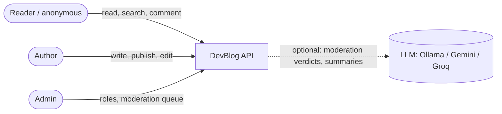
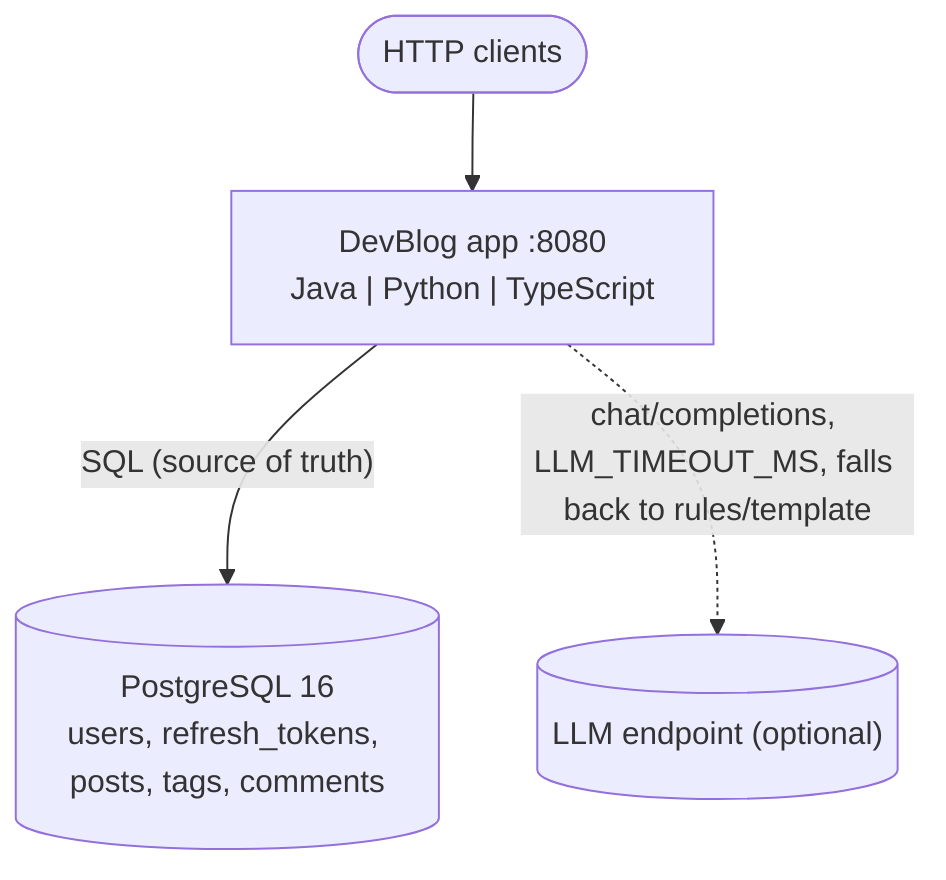
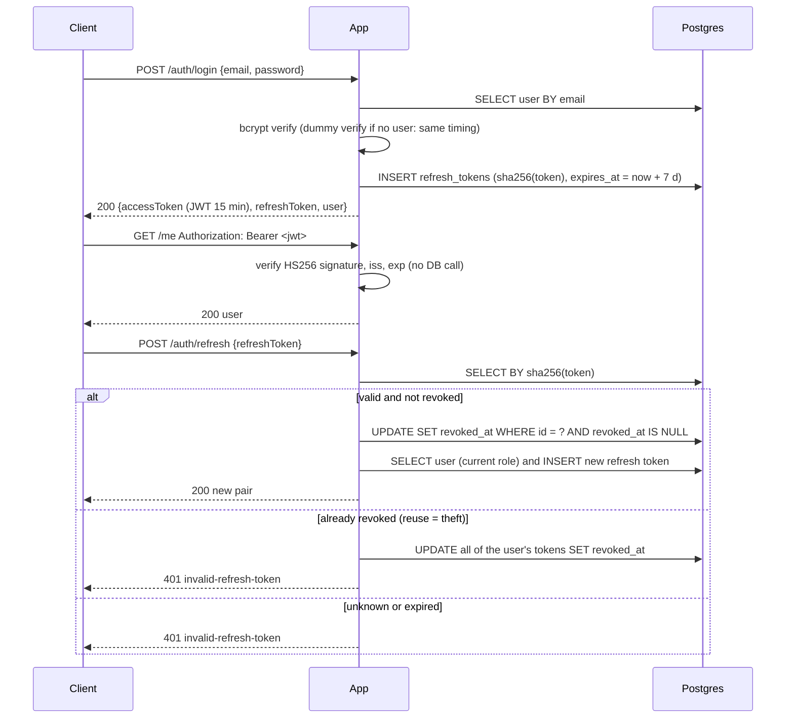
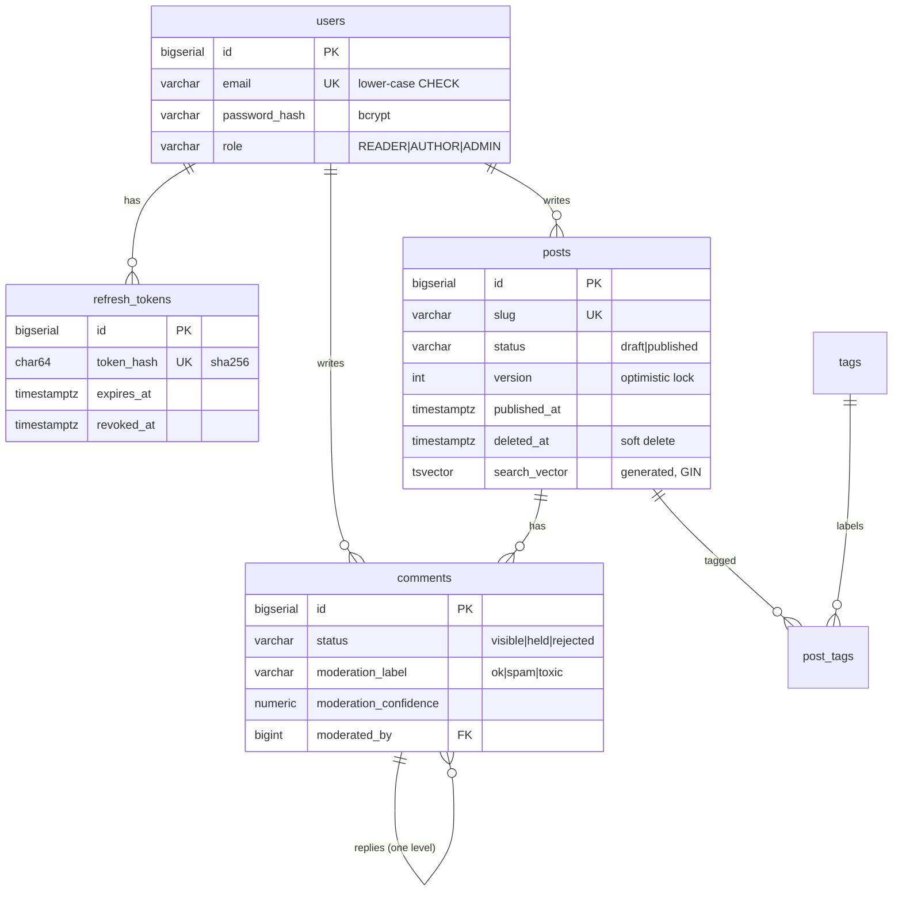

# DevBlog architecture

> Reference version (tag `phase-2-end`). Diagrams use Mermaid and render on GitHub.

## 1. Context diagram

DevBlog is a backend only. Any front end (web, mobile, the course's `curl` sessions) talks to it over
the HTTP contract in `openapi.yaml`.

## 2. Container diagram

Inside the app every track has the same layers:

| Layer | Responsibility | Knows about HTTP? | Knows about SQL? |
|---|---|---|---|
| HTTP (routes/controllers) | parse requests, read the `Authorization` header, map errors to `problem+json` | yes | no |
| Services (`AuthService`, `PostService`, `CommentService`) | business rules, **authorisation**, validation | no | no |
| Security (`PasswordHasher`, `TokenService`) | bcrypt, JWT, refresh-token generation and hashing | no | no |
| AI (`ModerationService`, `SummaryService`) | rules/template baseline, optional LLM, fallback | no | no |
| Repositories | SQL; in-memory fakes for unit tests | no | yes |

Only PostgreSQL is on the critical path. The LLM is optional; when it fails, users still get an answer
(NFR-4). Authorisation lives in the services, so the unit tests can prove every refusal without HTTP.

## 3. Login + refresh sequence

The compare-and-set `UPDATE … AND revoked_at IS NULL` makes two concurrent refreshes with the same
token safe: exactly one wins, the other is treated as reuse (tested in Phase 4).

## 4. Comment + moderation sequence
```mermaid
sequenceDiagram
    participant C as Client
    participant A as App
    participant L as LLM (optional)
    participant P as Postgres
    C->>A: POST /posts/{slug}/comments {body} (Bearer)
    A->>P: post exists, published, not deleted?
    alt LLM configured
        A->>L: classify <comment>…</comment> (timeout)
        alt valid JSON verdict
            L-->>A: {label, confidence, reason}
        else error / timeout / nonsense
            A->>A: rules verdict, fallback = true
        end
    else no LLM
        A->>A: rules verdict, fallback = false
    end
    A->>A: held if label != ok and confidence >= 0.7, else visible
    A->>P: INSERT comment with the verdict
    A-->>C: 201 {status: visible | held, moderation}
    Note over A,P: Later: admin POST /admin/comments/{id}/decision {approve|reject}<br/>sets status, moderated_by, moderated_at; the AI verdict is kept
```

## 5. Data model

Schema: [`db/migrations/V1__init.sql`](db/migrations/V1__init.sql). Key indexes:
- `idx_posts_feed (published_at DESC, id DESC) WHERE status = 'published' AND deleted_at IS NULL`: the
  feed and its keyset cursor read this index in order and stop after `limit + 1` rows.
- `idx_posts_search` (GIN on the generated `search_vector`): `websearch_to_tsquery('english', q)`.
- `idx_comments_post (post_id, created_at, id) WHERE deleted_at IS NULL` and `idx_comments_status`.

## 6. Contract map (OpenAPI path → requirement)
| Path | FR |
|---|---|
| `POST /api/v1/auth/register`, `/login`, `/refresh`, `/logout`; `GET /api/v1/me` | FR-1 … FR-5 |
| `PATCH /api/v1/admin/users/{id}/role` | FR-5 |
| `GET, POST /api/v1/posts`; `GET, PATCH, DELETE /api/v1/posts/{slug}` | FR-6 … FR-10 |
| `GET /api/v1/tags` | FR-11 |
| `GET, POST /api/v1/posts/{slug}/comments`; `DELETE /api/v1/comments/{id}` | FR-12 |
| `GET /api/v1/admin/comments`; `POST /api/v1/admin/comments/{id}/decision` | FR-13 |
| `GET /api/v1/posts/{slug}/summary` | FR-14 |
| `GET /health` | FR-15 |

## 7. Key decisions
- [ADR-0001](adr/0001-auth-jwt-and-rotating-refresh-tokens.md): short-lived JWT + opaque rotating refresh tokens with reuse detection
- [ADR-0002](adr/0002-keyset-pagination.md): keyset pagination with a millisecond cursor
- [ADR-0003](adr/0003-optimistic-locking.md): optimistic locking with a `version` column
- [ADR-0004](adr/0004-ai-moderation-human-in-the-loop.md): AI may hold, never reject; rules fallback
- [ADR-0005](adr/0005-no-spring-security-filter-chain.md): explicit authorisation in services (and no Spring Security filter chain in Java)
